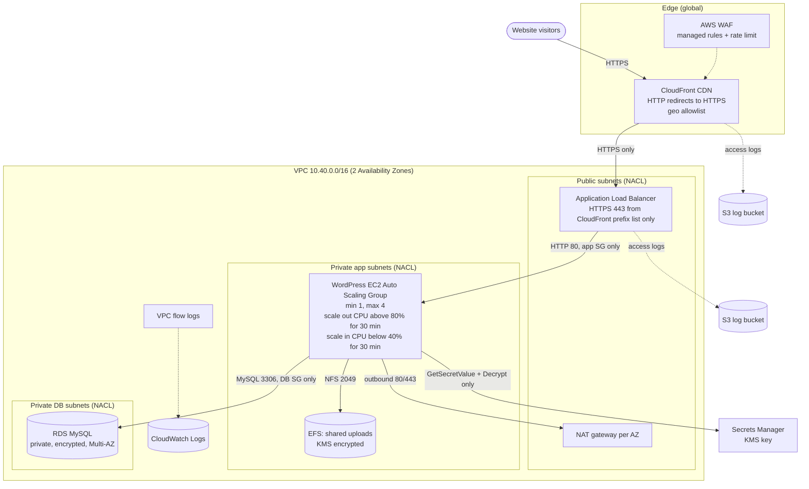
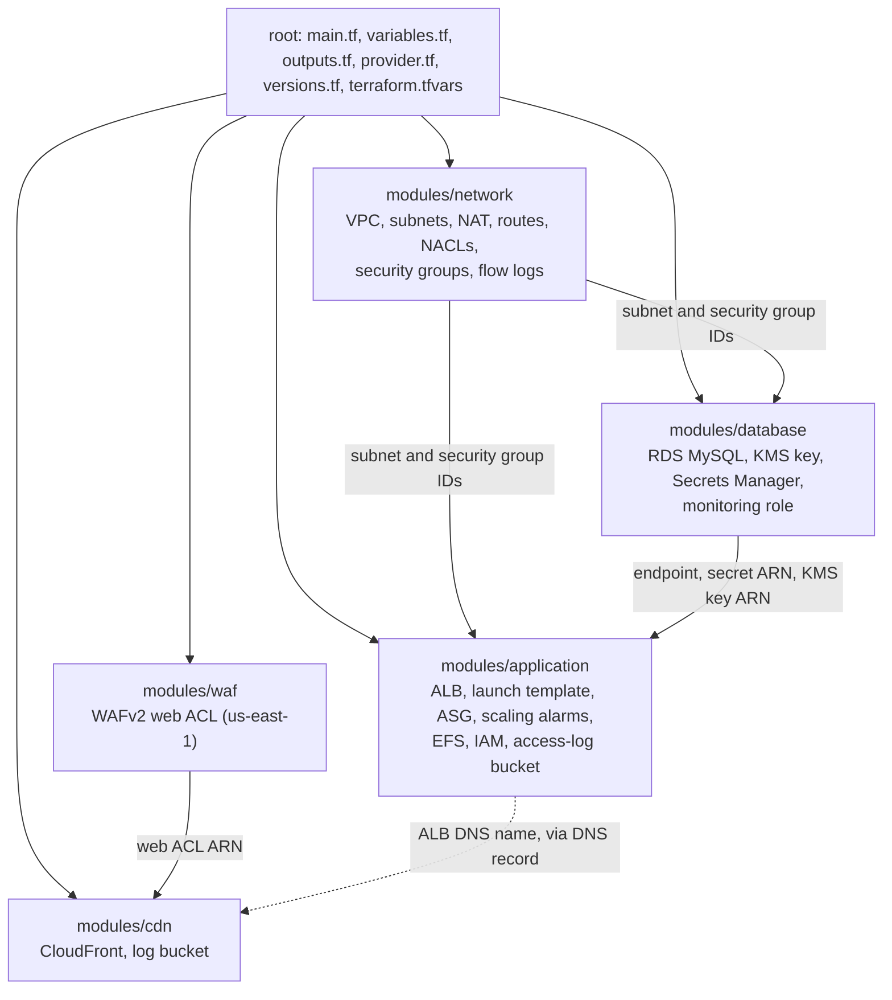

# Xtremax Cloud Engineer Assessment — Terraform Submission

This repository contains the Terraform implementation for the school WordPress assessment, architecture/module diagrams, and a validation/test record. The AWS test deployment is live at [https://assessment.zharifzhafran.xyz](https://assessment.zharifzhafran.xyz). It uses a separate test hostname so the existing apex and `www` DNS records stay untouched. See [docs/TEST_PLAN.md](docs/TEST_PLAN.md) for checks performed and remaining manual WordPress setup.

## Architecture



The assessment uses both “two-tier” and “three-tier” descriptions. This submission treats CloudFront as the edge layer, ALB plus WordPress as the web/application layer, and RDS as the data layer. Public and private subnet boundaries are documented in the Terraform network module. CloudFront redirects viewer HTTP to HTTPS and uses HTTPS to its custom origin. The ALB has an HTTPS listener only and its security group is limited to AWS’s CloudFront origin-facing managed prefix list; the app and DB security groups allow only the next required tier.

WordPress uploads are on EFS so all EC2 instances share media during scale-out or replacement. WordPress core is pinned to version `7.1.4` so each new instance starts with the same application version; this was the latest stable release in the official archive on November 4, 2026 ([WordPress release archive](https://wordpress.org/download/releases/)). The bootstrap disables WordPress dashboard file edits and updates so plugins/themes cannot silently diverge across instances; deploy plugin/theme changes through a reviewed, consistent bootstrap or image update. RDS is private and uses a generated password stored in Secrets Manager. The secret also stores one generated set of WordPress authentication keys and salts shared by every instance, so logins and nonces remain valid across ASG nodes. The EC2 role can read only that secret. Terraform state can contain sensitive database values and auth keys, so protect local/remote state and never include state in source control or the ZIP.

## Terraform structure



### Module structure

```text
terraform/                       <root>
├── main.tf                      combines all modules that build the school web project
├── variables.tf                 declares the variables used by main.tf
├── terraform.tfvars             input values for all modules (example values in terraform.tfvars.example)
├── outputs.tf                   final outputs once the stack is deployed
├── provider.tf, versions.tf     AWS providers (default and us-east-1 alias), pinned versions
├── plan.tftest.hcl              terraform test suite (mocked providers, no AWS needed)
└── modules/
    ├── network/                 VPC, subnets, NAT, routes, NACLs, security groups, flow logs
    ├── database/                RDS MySQL, KMS key, Secrets Manager, monitoring role
    ├── application/             ALB, launch template, Auto Scaling Group, alarms, EFS, IAM, log bucket
    ├── waf/                     WAFv2 web ACL for CloudFront (us-east-1)
    └── cdn/                     CloudFront distribution and log bucket
```

### Root files

- `main.tf` at the root: combines all module folders and wires module outputs to module inputs (network feeds database and application; database feeds application; waf feeds cdn).
- `terraform.tfvars`: the input values required by all modules. The ZIP ships a placeholder copy; the repository keeps `terraform.tfvars.example`.
- `outputs.tf` at the root: shows the website URL, CloudFront domain, ALB DNS name and Auto Scaling group name after deployment.
- `variables.tf` at the root: declares every variable used by `main.tf`.


Detailed per-module inputs and outputs are in the table below. The `network` module creates two AZs of public, private application, and private database subnets. App subnets use one NAT gateway per AZ for outbound package installation; database subnets have no internet default route. It creates an ALB, app, and DB security group plus subnet NACLs. The `database` module accepts private DB subnets and its pre-created security group. The `application` module accepts ALB/app groups and the database endpoint/secret ARN. The `cdn` module accepts a custom DNS origin alias routed to the ALB.

| Module | Inputs | Outputs |
|---|---|---|
| `network` | Name prefix, VPC CIDR, two AZ names, CloudFront origin-facing prefix-list ID, tags | VPC ID, public/app/database subnet IDs, ALB/app/database security-group IDs |
| `database` | Name prefix, DB name/user, instance class/storage, private DB subnet IDs, DB security group, backup settings, tags | RDS endpoint/port, KMS key ARN, secret ARN with generated DB credentials and shared WordPress auth keys, DB username |
| `application` | VPC/subnets, ALB/app security groups, DB endpoint/name/user/secret ARN, DB secret KMS key ARN, website domain, AMI/instance type, ASG capacity and CPU rules, ALB certificate ARN, tags | ALB DNS name/zone ID, ASG name, EFS ID |
| `waf` | Name prefix, tags | Web ACL ARN (created with the `us-east-1` provider alias) |
| `cdn` | Name prefix, origin DNS name, canonical website domain, matching viewer alias and ACM certificate in `us-east-1`, WAF web ACL ARN, geo allowlist, tags | CloudFront distribution ID and domain name |

Each module has `main.tf`, `variables.tf`, and `outputs.tf`. The root `main.tf` wires module outputs to downstream inputs. The sample inputs in `terraform.tfvars.example` are placeholders and must be replaced before deployment.

The root configuration pins the HashiCorp AWS provider to `6.62.0` and the Random provider to `3.9.1` for repeatable provider selection ([AWS provider registry](https://registry.terraform.io/providers/hashicorp/aws/latest/docs), [Random provider registry](https://registry.terraform.io/providers/hashicorp/random/latest/docs)). `terraform/.terraform.lock.hcl` is included; commit it.

## Inputs to replace before deployment

- `ami_id`: a current Amazon Linux 2023 AMI ID in `aws_region`.
- `cloudfront_prefix_list_id`: the AWS-managed CloudFront origin-facing prefix-list ID for the selected AWS region.
- `alb_certificate_arn`: an ACM certificate in `aws_region` covering the origin hostname.
- `cloudfront_origin_domain_name`: a DNS name routed to the ALB and covered by that certificate.
- `website_domain`: the canonical WordPress website hostname.
- `cloudfront_aliases`: must include `website_domain`; set a matching `cloudfront_viewer_certificate_arn` from ACM in `us-east-1`.
- DNS: route the origin hostname to the ALB and the viewer hostname to CloudFront. The assessment does not provide a domain or certificates.

The CloudFront viewer certificate must be in `us-east-1` when using an ACM certificate, and the origin certificate must match the origin hostname CloudFront uses. See [CloudFront certificate requirements](https://docs.aws.amazon.com/AmazonCloudFront/latest/DeveloperGuide/cnames-and-https-requirements.html) and [HTTPS to a custom origin](https://docs.aws.amazon.com/AmazonCloudFront/latest/DeveloperGuide/using-https-cloudfront-to-custom-origin.html). The CloudFront origin request policy forwards viewer headers except `Host`, plus cookies and query strings, for WordPress behavior; the default cache policy disables object caching to avoid caching authenticated/dynamic pages. See [AWS managed origin request policies](https://docs.aws.amazon.com/AmazonCloudFront/latest/DeveloperGuide/using-managed-origin-request-policies.html).

## Auto Scaling requirements

The ASG is configured with minimum size **1**, maximum size **4**, and a configurable desired size between them. CloudWatch uses 5-minute EC2 CPU periods with 6 consecutive periods (30 minutes): scale out above 80%; scale in below 40%. Each action changes capacity by one. The actual min/max bounds prevent scale-in below one or scale-out above four.

## Security controls

- Viewer and CloudFront-to-origin links use HTTPS. CloudFront redirects viewer HTTP to HTTPS; the ALB itself exposes only its HTTPS listener and forwards to EC2 over HTTP inside the VPC.
- The ALB security group accepts HTTPS only from the CloudFront origin-facing prefix list. The app group accepts HTTP from the ALB group and allows outbound NFS to EFS mount targets. The EFS group accepts NFS only from the app group. The DB group accepts MySQL only from the app group.
- Network ACLs are subnet-scoped and include return/ephemeral traffic for the allowed paths. Security groups provide the narrower tier-to-tier stateful controls.
- Application subnet rules allow TCP/UDP DNS queries only to the VPC resolver range; app security groups also allow DNS only to the VPC CIDR.
- EC2 has no public IP. RDS has `publicly_accessible = false`, private subnet placement, encryption, and backups.
- EC2 role permissions are limited to reading the one generated database secret. No AWS credentials are embedded in user data.
- The launch template installs pinned WordPress 7.1.4, imports the five pages and school styling from the pinned `demo/` revision, and initializes a test admin whose generated password stays in Secrets Manager. It starts PHP-FPM and Apache, enables WordPress permalinks, and retries secret/EFS access for transient startup failures. It retrieves one shared set of WordPress authentication keys and salts so sessions work across ASG instances. Dashboard file editing/updates are disabled so code changes are deployed consistently. Apache `AllowOverride` is needed for WordPress permalinks on Amazon Linux 2023, as described in the [AWS AL2023 WordPress guide](https://docs.aws.amazon.com/linux/al2023/ug/hosting-wordpress-aml-2023.html).
- Hardening: customer-managed KMS keys (database secret, EFS, flow logs), VPC flow logs, ALB and CloudFront access logs in private S3 buckets, WAFv2 managed rules with rate limiting, CloudFront geo allowlist (default ID/SG/MY, `cloudfront_geo_allowlist`), Multi-AZ RDS with enhanced monitoring, and deletion protection on RDS and the ALB. Set `deletion_protection = false` and apply before `terraform destroy`.
- The sample tfvars contains fake placeholders only. Terraform state is sensitive and excluded from the deliverable ZIP.

## Commands

Run from `terraform/` after replacing placeholder inputs and configuring AWS credentials for the account/region:

`terraform fmt`, `init`, `validate` and a `plan` (96 resources to add) all pass; see [docs/TEST_PLAN.md](docs/TEST_PLAN.md) and [docs/terraform-plan-output.txt](docs/terraform-plan-output.txt).

```powershell
terraform fmt -check -recursive
terraform test
terraform init
terraform validate
terraform plan -var-file="terraform.tfvars"
```

For a plan-only review with example values, copy `terraform.tfvars.example` to a local `terraform.tfvars`, replace the placeholders with syntactically valid values, and use `terraform plan -refresh=false`. Do not run `terraform apply` unless you intentionally want to create billable AWS resources and have confirmed the account, region, and cost implications. A live deployment is not required by the assessment.

See [docs/TEST_PLAN.md](docs/TEST_PLAN.md) for the requirement-to-check matrix and recorded validation status.

## Local WordPress demo

`demo/` runs a sample school website (WordPress and MySQL in Docker) so the application tier can be seen working without AWS. It is separate from the Terraform deployment; see [demo/README.md](demo/README.md).

## Submission checklist

- The assessment asks for the Terraform scripts, architecture/configuration/security documentation, system and module diagrams, and test plan/results together.
- This ZIP groups the Terraform files, this README, the test plan, and the implementation plan in one package. Send the deliverables together in one email by the assessment deadline: within four days of receiving the test case.
- A live AWS deployment is not required. The assessment accepts Terraform plan output as evidence.
